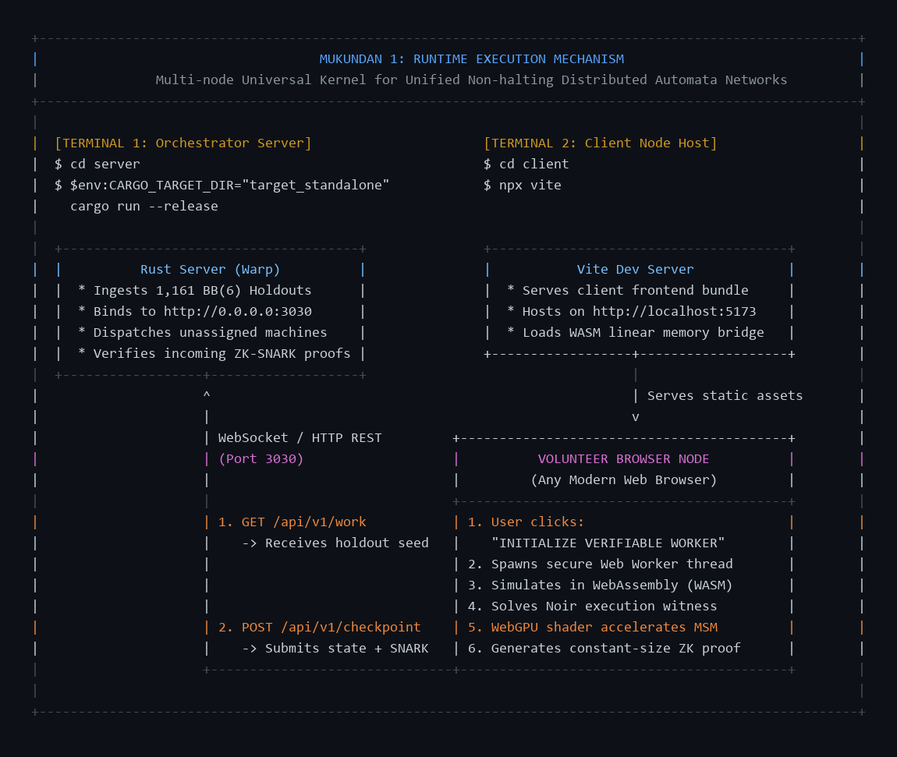

# MUKUNDAN 1
### Multi-node Universal Kernel for Unified Non-halting Distributed Automata Networks
**Verifiable Distributed Computation Engine for the Busy Beaver BB(6) Challenge**

[](https://www.rust-lang.org/)
[](https://noir-lang.org/)
[](https://www.w3.org/TR/webgpu/)
[](https://opensource.org/licenses/MIT)

MUKUNDAN 1 is a decentralized, zero-knowledge verifiable compute infrastructure designed to tackle open problems in computability theory—specifically the classification of the **1,161 remaining holdout Turing machines in the Busy Beaver BB(6) challenge**.

Following the collective 2024 resolution of BB(5), the 6-state Busy Beaver problem remains an active frontier. MUKUNDAN 1 transforms untrusted web browsers into verifiable compute nodes using WebAssembly, zero-knowledge SNARKs (Noir), and WebGPU acceleration.

---

## ⚡ Runtime Execution Flow



---

## 🏛️ Architecture Overview

```text
+-------------------------------------------------------------+
|                       MUKUNDAN 1                            |
+------------------+------------------+-----------------------+
|                  |                  |                       |
|  +-----------+   |  +-----------+   |  +-----------------+  |
|  | Python    |   |  | Rust      |   |  |  Browser Node   |  |
|  | Pipeline  |---+->| Server    |<-+- -|  (Web Worker)   |  |
|  |           |   |  | (Warp)    |   |  +-----------------+  |
|  +-----------+   |  +-----+-----+   |  | Rust -> WASM    |  |
|  holdouts.json   |        |         |  | MacroEngine     |  |
|                  |   WebSocket      |  |      |          |  |
|                  |   Signaling      |  | Noir ZK-SNARK   |  |
|                  |        |         |  | Prover          |  |
|                  |        v         |  |      |          |  |
|                  |  +-----------+   |  | WebGPU MSM      |  |
|                  |  | WebRTC    |<--+--| (Accelerator)   |  |
|                  |  | P2P Mesh  |   |  +-----------------+  |
|                  |  +-----------+   |                       |
|  +-----------+   |                  |                       |
|  | Noir      |   |                  |                       |
|  | Circuit   |---+------------------+-> ZK Verification     |
|  | (ACIR)    |   |                  |   Poseidon Merkle     |
|  +-----------+   |                  |   Transition Tree     |
+------------------+------------------+-----------------------+
```

---

## 🔬 Core Innovations

### 1. $O(1)$ Poseidon Hash-Chain Tape Stack (`core/src/macro_engine.rs`)
Turing machines have infinite memory, whereas ZK-SNARK circuits require fixed-size constraint systems. Storing or unrolling tape memory inside a circuit causes constraint explosion. 
- MUKUNDAN 1 models the tape as two directional stacks of run-length-encoded symbol blocks.
- Each block is committed into a rolling Poseidon hash chain: $\text{Hash}_{i} = \mathcal{H}(\text{symbol}, \text{count}, \text{Hash}_{i-1})$.
- The ZK circuit only validates local hash transitions (pushes and pops), verifying unbounded tape modifications with **two 32-byte field elements**.

### 2. Transition Table Merkle Commitments (`core/src/tnf_tree.rs`, `circuits/src/main.nr`)
- The 12 state-symbol transition rules of each 6-state machine are committed into a depth-4 Poseidon Merkle tree.
- The root hash commits the immutable machine definition. Every proven step provides a 4-sibling authentication path to prove strict adherence to the machine's rule table.

### 3. Zero-Copy WASM $\leftrightarrow$ JS Memory Layout (`wasm-bridge/src/lib.rs`)
- Uses `#[repr(C, align(16))]` for `CheckpointLayout`.
- `run_chunk()` returns raw pointers into WASM linear memory, enabling the client JavaScript runtime to directly construct TypedArray views (`BigUint64Array`, `Uint8Array`) with zero serialization overhead.

### 4. WebGPU Finite-Field Arithmetic Shader (`gpu-prover/src/bn254_msm.wgsl`)
- Implements U256 multi-precision arithmetic (8x 32-bit limbs with manual carry/borrow propagation) and prime field modular reduction directly in WGSL for the BN254 curve ($q = 21888242871839275222246405745257275088696311157297823662689037894645226208583$).

---

## 📦 Project Structure

```
mukundan-1/
├── circuits/           # Noir ZK-SNARK circuit definitions & constraints
│   ├── src/main.nr     # Transition and step verification circuit
│   └── src/memory.nr   # Memory multiset consistency arguments
├── core/               # Rust simulation engine (compiles to native & wasm32)
│   ├── src/macro_engine.rs # Macro-stepping engine with Poseidon hash-chain
│   ├── src/smt.rs          # Depth-64 Sparse Merkle Tree
│   └── src/tnf_tree.rs     # Transition table Merkle tree
├── wasm-bridge/        # WebAssembly bindings & WebRTC DataChannel networking
├── gpu-prover/         # WebGPU WGSL compute shader for BN254 MSM
├── server/             # Warp orchestrator and holdout scheduler
├── client/             # Web Worker client pipeline with NoirJS & Barretenberg
├── data/               # 1,161 canonical BB(6) holdout definitions & visual assets
└── scripts/            # Synchronization pipeline from bbchallenge.org
```

---

## 🚀 How to Run MUKUNDAN 1

Running the system requires **two concurrent terminal processes**:

### Terminal 1: Orchestrator Backend Server
Navigate into the `server/` directory and run:

```powershell
cd server
$env:CARGO_TARGET_DIR="target_standalone"; cargo run --release
```
*(On Linux / macOS: `cd server && CARGO_TARGET_DIR="target_standalone" cargo run --release`)*

**Terminal 1 Output:**
```text
--- MUKUNDAN 1: Beaver-Grid Orchestrator Booting ---
Beaver-Grid Scheduler Initialized: 1161 Holdouts ingested.
Orchestrator online. Listening on 0.0.0.0:3030...
```

---

### Terminal 2: Volunteer Browser Node Host
In a second terminal window, host the browser node:

```powershell
cd client
npx vite
```

**Terminal 2 Output:**
```text
  VITE v8.0.x  ready in 150 ms

  ➜  Local:   http://localhost:5173/
  ➜  Network: use --host to expose
```

---

### 3. Start Verifiable Computation
1. Open your browser and navigate to **`http://localhost:5173`**.
2. Click **`INITIALIZE VERIFIABLE WORKER`**.
3. The node connects to Terminal 1 on `:3030`, fetches undecided BB(6) machines, simulates them via WebAssembly, solves execution witnesses, compiles ZK-SNARK proofs, and streams verified checkpoints back to the orchestrator.

---

## 🛠️ Status & Transparent Limitations

- **Pippenger Bucket Accumulation:** U256 addition, subtraction, comparison, and modular reduction are fully implemented in `bn254_msm.wgsl`. The Pippenger accumulation loop across base points is currently an architectural stub.
- **Recursive Folding (IVC):** Currently verifies macro-steps individually. Incremental Verifiable Computation (Protogalaxy / Nova) is planned to fold thousands of execution steps into a single recurring proof.
- **Persistence:** Scheduler state is maintained in-memory for active sessions (`server/src/db_connector.rs` persistence is in progress).
